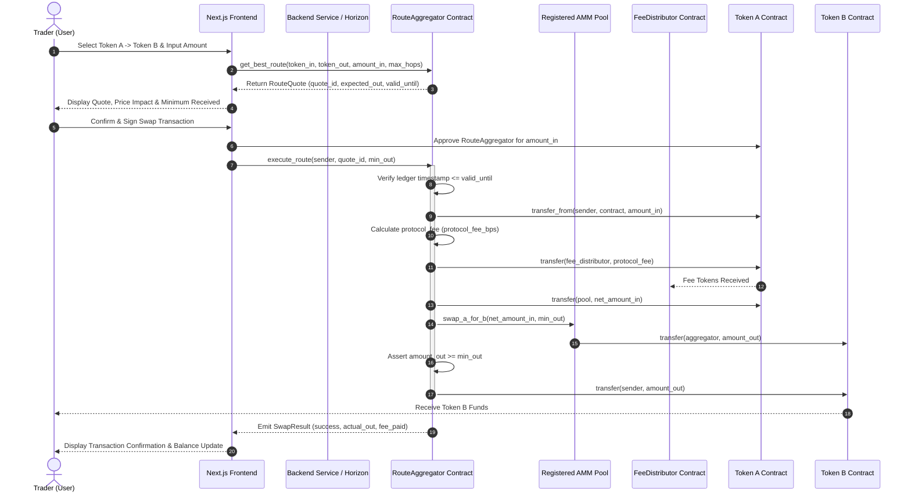
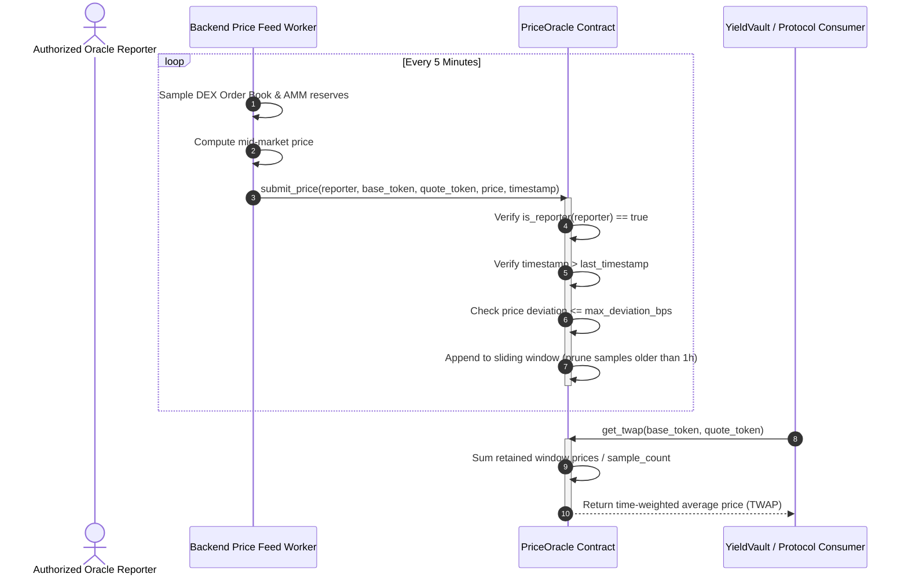

# YieldRoutes — Architecture Deep Dive & Contract Communication Flow

## Protocol Primitives & Overview

YieldRoutes unites two complementary DeFi primitives on the Stellar network:

```
RouteAggregator                  YieldVault (ERC-4626)
────────────────────────         ─────────────────────────────
Finds optimal swap route         Accrues yield on idle assets
across Soroban AMM pools         via automated compounder

Users swapping tokens get        Users holding assets get
minimized slippage & best        continuous yield compounding
execution price                  without principal dilution
```

```mermaid
flowchart TD
    subgraph ClientLayer["Client & Integration Layer"]
        User["User / Trader / Depositor"]
        UI["YieldRoutes Web UI (Next.js)"]
        Backend["Backend Service & Cron Schedulers"]
    end

    subgraph SorobanContracts["Soroban Smart Contracts Layer"]
        Aggregator["RouteAggregator Contract"]
        Vault["YieldVault Contract (ERC-4626)"]
        Distributor["FeeDistributor Contract"]
        Oracle["PriceOracle Contract (TWAP)"]
        Pool["Registered Liquidity Pools / AMMs"]
    end

    subgraph Beneficiaries["Protocol Stakeholders & Treasury"]
        Treasury["Protocol Treasury"]
        LP["Liquidity Providers (LP Pool)"]
    end

    User -->|1. Request Quote / Execute Swap| Aggregator
    User -->|2. Deposit Assets / Redeem Shares| Vault
    Backend -->|Polls Horizon / Submits TWAP Prices| Oracle
    Backend -->|Triggers Periodic Harvest / Distribution| Vault
    Backend -->|Triggers Fee Distribution| Distributor

    Aggregator -->|Cross-Contract Swap| Pool
    Aggregator -->|Protocol Swap Fees| Distributor

    Distributor -->|Treasury Split (50%)| Treasury
    Distributor -->|Yield Compound Split (30%)| Vault
    Distributor -->|LP Rewards Split (20%)| LP

    Vault -.->|Reads Validated Price / Valuation| Oracle
```

---

## Core Contract Architecture & Roles

Each Soroban smart contract is modular, single-responsibility, and cross-linked to its upstream repository source:

| Contract | Primary Responsibilities | Source Link |
|---|---|---|
| **RouteAggregator** | Maintains registered AMM liquidity pools; computes optimal execution routes; validates timestamps & slippage boundaries; executes atomic token swaps. | [`contracts/route_aggregator/src/lib.rs`](https://github.com/Yield-routes/Yield-routes-Contracts/tree/main/contracts/route_aggregator/src/lib.rs) |
| **YieldVault** | Implements ERC-4626 vault standard on Soroban; manages user deposits/withdrawals; issues vault shares; compounds yield via `harvest()` without share dilution. | [`contracts/yield_vault/src/lib.rs`](https://github.com/Yield-routes/Yield-routes-Contracts/tree/main/contracts/yield_vault/src/lib.rs) |
| **FeeDistributor** | Collects protocol swap fees; enforces distribution schedules; splits fees proportionally between Treasury (50%), YieldVault (30%), and LP Rewards (20%). | [`contracts/fee_distributor/src/lib.rs`](https://github.com/Yield-routes/Yield-routes-Contracts/tree/main/contracts/fee_distributor/src/lib.rs) |
| **PriceOracle** | Collects multi-reporter price submissions; calculates time-weighted average prices (TWAP); enforces maximum volatility/deviation guards; serves asset valuation. | [`contracts/price_oracle/src/lib.rs`](https://github.com/Yield-routes/Yield-routes-Contracts/tree/main/contracts/price_oracle/src/lib.rs) |

---

## Inter-Contract Communication Matrix

The protocol relies on cross-contract invocations on Soroban:

```mermaid
graph LR
    User["User"] -->|execute_route()| Aggregator["RouteAggregator"]
    Aggregator -->|swap_a_for_b() / swap_b_for_a()| Pool["Soroban AMM Pool"]
    Aggregator -->|transfer(protocol_fee)| Distributor["FeeDistributor"]

    Distributor -->|transfer(vault_split)| Vault["YieldVault"]
    Distributor -->|transfer(treasury_split)| Treasury["Treasury"]
    Distributor -->|transfer(lp_split)| LP["LP Rewards"]

    Reporter["Backend Oracle Worker"] -->|submit_price()| Oracle["PriceOracle"]
    Vault -.->|get_twap() / get_latest_price()| Oracle
```

### Cross-Contract Call Details

| Caller Contract / Actor | Callee Contract | Invocation Entrypoint | Data Passed | Result / Purpose |
|---|---|---|---|---|
| **User / Frontend** | `RouteAggregator` | `execute_route(sender, quote_id, min_out)` | Quote ID, sender address, slippage bound | Validates expiration, locks input, routes trade. |
| **RouteAggregator** | `Soroban Pool Contract` | `swap_exact_tokens_for_tokens()` | `amount_in`, `min_out`, path | Performs underlying AMM swap against pool liquidity. |
| **RouteAggregator** | `FeeDistributor` (Fee Collector) | `token::Client.transfer()` | `protocol_fee` amount | Routes accrued protocol fees into distribution vault. |
| **FeeDistributor** | `YieldVault` | `token::Client.transfer()` & `harvest()` | 30% fee share | Injects protocol fee revenue as vault yield. |
| **FeeDistributor** | `Treasury` / `LP Pool` | `token::Client.transfer()` | 50% / 20% shares | Dispatches operational treasury and LP incentive tokens. |
| **Backend Service** | `PriceOracle` | `submit_price(reporter, base, quote, price, ts)` | Asset pair, signed price, timestamp | Appends observation to circular TWAP sample window. |
| **YieldVault** | `PriceOracle` | `get_twap(base_token, quote_token)` | Token addresses | Obtains tamper-resistant valuation for share accounting. |

---

## Detailed Token & Value Flows

### 1. Token Flow: Swap Execution
During a swap, tokens follow a strictly audited non-custodial path:
1. **User Authorizes Spend**: User signs transaction authorizing `RouteAggregator` to transfer `amount_in` of `TokenA`.
2. **Protocol Fee Deduction**: Protocol fee (`protocol_fee_bps`, e.g. 10 bps / 0.1%) is calculated. Fee is transferred directly to `fee_collector` (`FeeDistributor`).
3. **Execution Over Registered Pools**: Net swap amount (`amount_in - protocol_fee`) is supplied to the target Soroban AMM pool contract (`swap_a_for_b`).
4. **Slippage Invariant Check**: The resulting `amount_out` from the AMM is verified against `min_out` specified by the user. If `amount_out < min_out`, the transaction reverts immediately.
5. **Settlement**: `amount_out` of `TokenB` is credited directly to the user's recipient address.

```
[User TokenA] 
      │
      ├───────────► (0.1% Fee) ──► [FeeDistributor]
      ▼
(99.9% Net In) ──► [Registered AMM Pool] ──► (TokenB Out) ──► [User TokenB]
```

---

### 2. Token Flow: Vault Deposit & Share Issuance (ERC-4626)
1. **Deposit**: User deposits `assets` into `YieldVault`.
2. **Share Calculation**: The contract calculates `shares` according to the current share price formula:
   $$\text{shares} = \frac{\text{assets} \times \text{total\_shares}}{\text{total\_assets}}$$
   *(If `total_assets == 0` or `total_shares == 0`, shares are minted 1:1 with initial precision).*
3. **Asset Custody & Minting**: Underlying assets are transferred to the vault contract address, and corresponding vault share tokens (`yvToken`) are minted to the receiver.

```
User (Underlying Asset) ──► [YieldVault Contract Balance]
                                    │
                                    └─► Mints proportional yvShares ──► User
```

---

### 3. Token Flow: Yield Harvesting & Compounding
1. **Harvest Trigger**: Backend scheduler or external keeper triggers `harvest(gross_yield)`.
2. **Asset Inflow**: Yield accrued from external pool strategies or protocol fee injections is transferred into `YieldVault`.
3. **Share Price Expansion**:
   - `total_assets` increases by `gross_yield`.
   - `total_shares` remains strictly constant (no new shares are minted).
   - Consequently, the ratio $\frac{\text{total\_assets}}{\text{total\_shares}}$ increases, directly growing the redeemable asset value for all existing share holders without dilution.

```
Harvest Revenue (+Yield Assets) ──► [YieldVault total_assets]
                                           ▲
                                           │ (total_shares unchanged)
                                           └─► Share Price Increases!
```

---

### 4. Token Flow: Fee Distribution Cycle
Accumulated protocol fees inside `FeeDistributor` are released via `distribute(amount)` (rate-limited to authorized intervals):
- **50% to Treasury**: Sent to protocol multi-sig/operations wallet for infrastructure & maintenance.
- **30% to YieldVault**: Injected directly into the vault balance as auto-compounded yield.
- **20% to LP Rewards Pool**: Allocated to incentivize liquidity providers in registered AMM pools.

```
Total Accumulated Fees (100%)
  │
  ├─ 50% ──► Treasury Address
  ├─ 30% ──► YieldVault (Triggers vault harvest value accretion)
  └─ 20% ──► Liquidity Provider Reward Vault
```

---

## Full Swap Lifecycle Sequence Diagram

The following Mermaid sequence diagram illustrates the complete end-to-end swap lifecycle, spanning user interactions, frontend simulation, backend pricing, and Soroban on-chain execution:



---

## Price Oracle Update & TWAP Consumption Flow

The `PriceOracle` maintains price security through authenticated multi-reporter submissions and time-weighted calculations:



---

## Backend & Automation Service Architecture

The backend integration points are maintained in [`yield-routes-backend/src/services/stellar.service.ts`](https://github.com/Yield-routes/Yield-routes-Backend):

```
Backend Node Process (node-cron engine)
  │
  ├─► Price Feed Daemon ("*/5 * * * *")
  │     1. Queries Horizon REST API for Stellar DEX order books.
  │     2. Computes weighted mid-price across liquidity pairs.
  │     3. Signs & submits Soroban transaction calling PriceOracle.submit_price().
  │     4. Persists price tick snapshot in PostgreSQL for historical charts.
  │
  └─► Vault Harvest & Fee Daemon ("0 */6 * * *")
        1. Evaluates accrued yield across connected liquidity strategies.
        2. Calls YieldVault.harvest(gross_yield).
        3. Invokes FeeDistributor.distribute() when minimum distribution threshold is met.
        4. Emits indexed telemetry events for frontend APY displays.
```

---

## Security Invariants & Formal Protocol Guarantees

1. **State Isolation & Reentrancy Freedom**: All Soroban contract invocations follow checks-effects-interactions patterns. Token transfers occur only after state validations.
2. **Slippage Protection**: `RouteAggregator.execute_route` strictly enforces `actual_out >= min_out`, reverting the entire atomic transaction if liquidity changes unfavorably.
3. **Time-Bound Quotes**: Quotes contain expiration ledgers (`valid_until`), preventing stale quote exploitation under network delays.
4. **TWAP Manipulation Resistance**: Vault asset evaluations utilize time-weighted averages over multi-sample windows, neutralizing single-block flash loan perturbations.
5. **Share Price Monotonicity**: Shares are never burned or minted during a `harvest()`; vault assets only expand, guaranteeing share value cannot be diluted by yield events.
