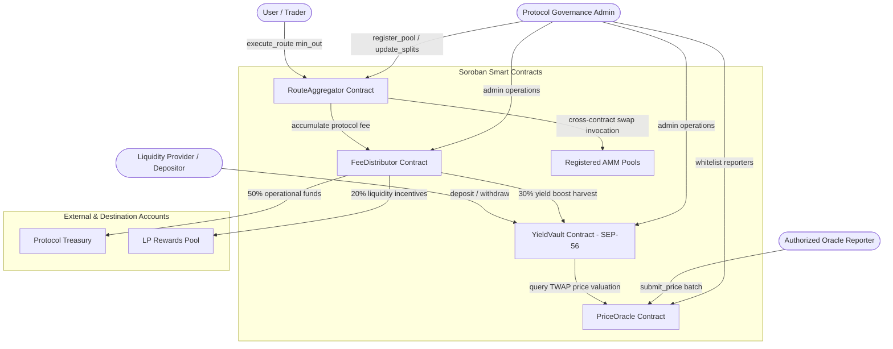
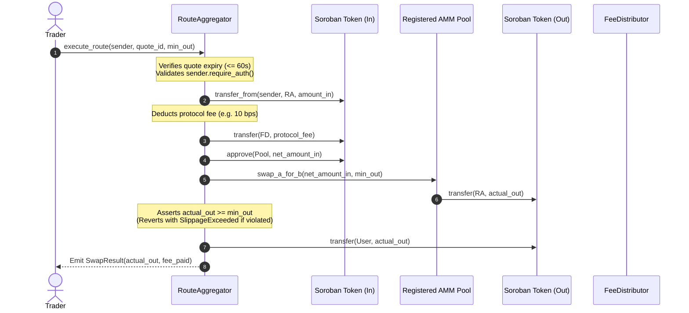
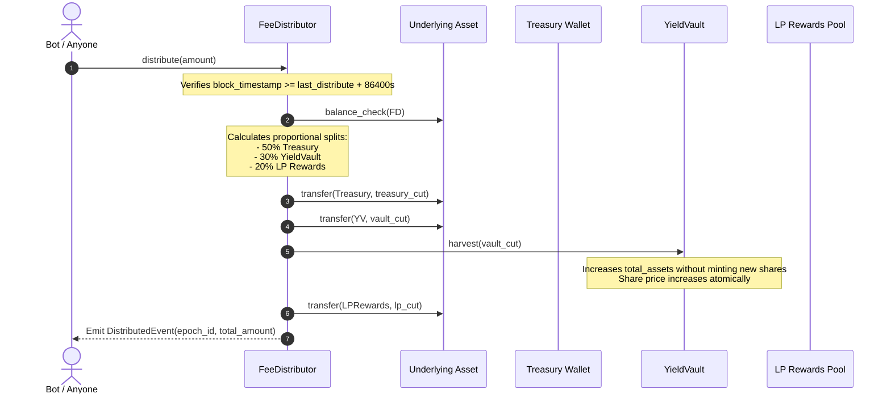
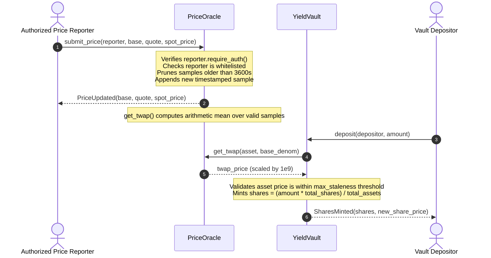

# YieldRoutes — Contract Reference

## RouteAggregator

> ⚠️ **Stellar constraint**: Soroban contracts cannot access the Stellar classic
> DEX or SDEX order books. All routing goes through registered Soroban AMM pool
> contracts. See `register_pool()`.

### initialize(admin, fee_collector, protocol_fee_bps)
Deploy the aggregator. `protocol_fee_bps` is hard-capped at 100 (1%).

### register_pool(token_a, token_b, pool)
Admin-only. Registers a Soroban AMM pool for the given token pair.
Both orderings (A→B and B→A) are stored for symmetric lookup.
The pool contract must implement `swap_a_for_b(amount_in, min_out)` and
`quote_a_for_b(amount_in)` methods matching the StableSwap interface.

### get_best_route(token_in, token_out, amount_in, max_hops) → RouteQuote
Returns the best route across registered AMM pools.
Quote is valid for 60 seconds (QUOTE_TTL_SECONDS).
Returns `NoRouteFound` error if no pool is registered for the pair.

### execute_route(sender, quote_id, min_out) → SwapResult
Executes a valid quote. Checks expiry, pulls `amount_in` from sender,
deducts protocol fee, routes through pool, delivers output to sender.
`min_out` is enforced via `SlippageExceeded`.

### update_protocol_fee(new_fee_bps)
Admin-only. Capped at 100 bps. Emits no event (fee changes are admin ops).

### get_pool(token_a, token_b) → Option<Address>
Returns the registered pool for a token pair, or None.

### get_pool_list() → Vec<(Address, Address)>
Returns all registered token pairs.

### get_total_volume() → i128
Cumulative `amount_in` across all executed routes.

---

## YieldVault (SEP-56 Tokenized Vault Standard)

The vault implements the Stellar SEP-56 standard (equivalent to ERC-4626).
The vault contract itself acts as the SEP-41 fungible share token (`yrUSDC`).

### SEP-56 Asset Information

| Function | Returns | Description |
|----------|---------|-------------|
| `query_asset()` | `Address` | The underlying asset (e.g. USDC) |
| `total_assets()` | `i128` | Total underlying tokens in vault (increases after harvest) |

### SEP-56 Conversion

| Function | Returns | Description |
|----------|---------|-------------|
| `convert_to_shares(assets)` | `i128` | Equivalent shares for given assets, rounds DOWN |
| `convert_to_assets(shares)` | `i128` | Equivalent assets for given shares, rounds DOWN |

### SEP-56 Limits

| Function | Returns |
|----------|---------|
| `max_deposit(receiver)` | `i128::MAX` (no deposit limit) |
| `max_mint(receiver)` | `i128::MAX` |
| `max_withdraw(owner)` | Owner's full share balance converted to assets |
| `max_redeem(owner)` | Owner's share balance |

### SEP-56 Preview functions (read-only, no state change)

| Function | Rounding | Protects |
|----------|----------|---------|
| `preview_deposit(assets)` → shares | DOWN | — |
| `preview_mint(shares)` → assets | UP | vault (caller pays at least this much) |
| `preview_withdraw(assets)` → shares | UP | vault (caller burns at least this many) |
| `preview_redeem(shares)` → assets | DOWN | — |

### SEP-56 State-changing functions

| Function | Auth | Description |
|----------|------|-------------|
| `deposit(assets, receiver, from)` | `from` | Transfer assets, mint shares to receiver |
| `mint(shares, receiver, from)` | `from` | Mint exact shares, pull required assets from `from` |
| `withdraw(assets, receiver, owner, operator)` | `operator` | Transfer exact assets, burn shares from owner |
| `redeem(shares, receiver, owner, operator)` | `operator` | Burn shares, transfer proportional assets |

For `withdraw` and `redeem`, if `operator ≠ owner`, the operator must have
an allowance set via `approve()`.

### SEP-41 Token Interface (share token)

| Function | Description |
|----------|-------------|
| `name()` | Share token name (e.g. "YieldRoutes USDC") |
| `symbol()` | Share token symbol (e.g. "yrUSDC") |
| `decimals()` | Base decimals + DECIMALS_OFFSET (7 + 7 = 14) |
| `balance(id)` | Share balance of address |
| `total_supply()` | Total outstanding shares |
| `transfer(from, to, amount)` | Transfer shares |
| `transfer_from(spender, from, to, amount)` | Transfer via allowance |
| `approve(from, spender, amount, expiration_ledger)` | Set allowance |
| `allowance(from, spender)` | Read allowance |

### Vault management

| Function | Auth | Description |
|----------|------|-------------|
| `harvest(gross_yield)` | Admin | Add yield to `total_assets`. Performance fee deducted. Remaining increases share price. |
| `pause()` / `resume()` | Admin | Emergency controls. Pause blocks `deposit()` and `mint()`. |
| `get_harvest_count()` | — | Number of harvest cycles |
| `get_total_yield_harvested()` | — | Cumulative net yield (post-fee) |
| `is_paused()` | — | Vault pause status |

### Inflation attack protection

YieldVault uses a **virtual shares offset** (`10^7`) to prevent the ERC-4626
inflation attack:

```
shares_minted = assets * (total_supply + 10^7) / (total_assets + 1)
```

An attacker cannot manipulate the share price by front-running the first
deposit because the virtual 10^7 denominator makes the share price
effectively bounded regardless of the vault's real balance.

---

## FeeDistributor

### initialize(admin, token, treasury, yield_vault, lp_rewards, treasury_bps, vault_bps, lp_bps)
`treasury_bps + vault_bps + lp_bps` must equal exactly 10,000.

### distribute(amount)
Callable by anyone, once per 24-hour epoch. Distributes `amount` of the
underlying token proportionally to treasury, vault, and LP rewards pool.
Reverts if fewer than `epoch_duration_seconds` have elapsed since last call.

### update_splits(treasury_bps, vault_bps, lp_bps)
Admin-only. Splits must still sum to 10,000.

---

## PriceOracle

### initialize(admin, max_deviation_bps)
`max_deviation_bps` is reserved for future slippage guard enforcement
in `RouteAggregator.execute_route()`.

### add_reporter(address) / remove_reporter(address)
Admin manages the whitelist of authorized price reporters.

### submit_price(reporter, base_token, quote_token, price)
Reporter-only. `price` is scaled by `10^9`
(e.g. `1.05 USDC/XLM = 1_050_000_000`).
Stale samples (older than `TWAP_WINDOW_SECONDS = 3600`) are pruned.

### get_twap(base_token, quote_token) → i128
Rolling 1-hour TWAP over up to 20 samples.

### get_latest_price(base_token, quote_token) → i128
Most recent price sample (spot, not averaged).

### get_price_data(base_token, quote_token) → PriceData
Returns `{ latest_price, twap_price, sample_count, oldest_sample_ts, newest_sample_ts }`.

---

## Inter-Contract Architecture & Communication Flows

YieldRoutes coordinates four standalone Soroban smart contracts on the Stellar network. While each contract encapsulates a single responsibility, they interact cross-contract to deliver atomic swaps, auto-compounding yield, decentralized fee routing, and tamper-resistant pricing.

### 1. Global Contract Topology & Call Graph



---

### 2. Token Swap Execution Sequence Flow

When a user executes a multi-hop swap via the `RouteAggregator`:



#### Authorization & Cross-Contract Requirements:
- `sender.require_auth()` is strictly enforced on `execute_route`.
- `RouteAggregator` invokes the AMM pool contract client dynamically using `env.invoke_contract(...)`.
- `TokenIn` and `TokenOut` adhere to the Soroban Token Interface (SEP-41).

---

### 3. Yield Accrual & Fee Distribution Flow

Protocol revenue collected by `RouteAggregator` and external pool yields are routed through `FeeDistributor` every 24-hour epoch:



#### Invariant Guarantees:
- Split ratios are constrained by: `treasury_bps + vault_bps + lp_bps == 10000` (100.00%).
- `YieldVault.harvest()` can only be invoked by authorized distributor contracts to prevent artificial share price dilution or manipulation.

---

### 4. Oracle Price Reporting & Vault Valuation Flow

The `PriceOracle` maintains time-weighted average prices (TWAP) across rolling 1-hour windows to insulate downstream pricing from single-slot manipulation:



#### Anti-Manipulation Properties:
- **Flash-Loan Resistance**: Single-block transient price spikes on AMMs do not shift the TWAP since historical samples are uniformly weighted over the 1-hour buffer.
- **Outlier Mitigation**: The oracle bounds maximum price deviation per update epoch against previous rolling averages.
